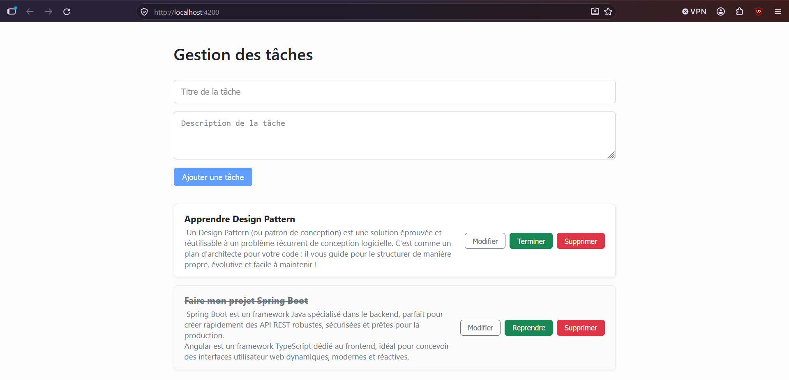
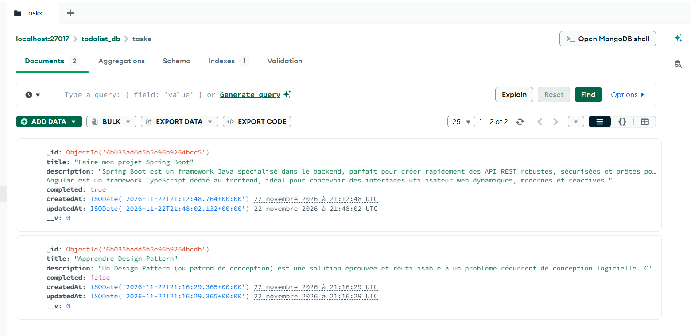

# TP N°2 : Gestion des Tâches (To-Do List) avec le MEAN Stack

**Établissement :** ENSA Fès - Filière ILIA2  
**Matière :** Technologies du Web / MEAN Stack  
**Professeur :** M. Youness IDRISSI KHAMLICHI  

---

##  Présentation du Projet

Ce projet implémente une application complète de gestion de tâches (**To-Do List**) basée sur l'architecture **MEAN Stack** (**M**ongoDB, **E**xpress.js, **A**ngular, **N**ode.js).

L'application respecte l'ensemble des exigences fonctionnelles et techniques demandées dans le sujet du TP et reproduit fidèlement l'interface utilisateur fournie.

---

## 🏗️ Architecture du MEAN Stack

```
+-------------------------------------------------------------+
|                      Client Angular                         |
|                 (Frontend - Port 4200)                      |
|  - Composants Standalone réactifs                           |
|  - Service Angular TaskService (HttpClient)                 |
|  - Formulaire Angular (FormsModule)                          |
+-------------------------------------------------------------+
                              |
                     Requêtes HTTP REST
                 (GET, POST, PUT, DELETE)
                              |
                              v
+-------------------------------------------------------------+
|                     Serveur Express.js                      |
|                  (Backend - Port 3000)                      |
|  - Routage RESTful (/tasks, /tasks/:id)                     |
|  - Contrôleurs & Gestion des erreurs                        |
|  - Middleware CORS, JSON parser                             |
+-------------------------------------------------------------+
                              |
                        Mongoose ODM
                              |
                              v
+-------------------------------------------------------------+
|                      Base MongoDB                           |
|               (todolist_db - Port 27017)                    |
|  - Collection 'tasks' : title, description, completed       |
+-------------------------------------------------------------+
```

---

##  Fonctionnalités Implémentées

1. **Création de tâches :** Formulaire permettant d'ajouter une tâche avec un **titre** obligatoire et une **description** facultative.
2. **Consultation de la liste :** Affichage de toutes les tâches triées par date de création, avec leur statut (terminée ou active).
3. **Mise à jour des tâches :**
   - **Changement de statut :** Bouton vert **Terminer** / **Reprendre** pour basculer l'état (avec titre barré si terminée).
   - **Modification du contenu :** Bouton **Modifier** ouvrant une édition en ligne du titre et de la description.
4. **Suppression de tâches :** Bouton rouge **Supprimer** avec confirmation préalable.
5. **Interface utilisateur soignée :** Design moderne et épuré conforme à la maquette de la page 3 du TP.

---

## 📂 Structure du Projet

```
TP2_ToDoList/
├── assets-demo/
│   ├── Resultat.png              # Capture d'écran des tests et de l'interface utilisateur
│   └── database.png              # Preuve du stockage persistant des tâches dans MongoDB
│
├── backend/
│   ├── config/
│   │   └── db.js                 # Configuration de la connexion MongoDB
│   ├── controllers/
│   │   └── taskController.js     # Logique métier CRUD
│   ├── models/
│   │   └── Task.js               # Schéma Mongoose de la tâche
│   ├── routes/
│   │   └── taskRoutes.js         # Définition des routes Express
│   ├── .env                      # Variables d'environnement (PORT, MONGODB_URI)
│   ├── .env.example              # Exemple de fichier .env
│   ├── package.json              # Dépendances backend (express, mongoose, cors, dotenv)
│   └── server.js                 # Point d'entrée de l'API Node.js
│
├── frontend/
│   ├── src/
│   │   ├── app/
│   │   │   ├── models/
│   │   │   │   └── task.model.ts     # Interface TypeScript Task
│   │   │   ├── services/
│   │   │   │   └── task.service.ts   # Service HTTP pour communiquer avec l'API
│   │   │   ├── app.ts                # Logique du composant principal
│   │   │   ├── app.html              # Template HTML conforme à la capture du TP
│   │   │   ├── app.css               # Feuilles de style de l'application
│   │   │   └── app.config.ts         # Configuration des providers (HttpClient)
│   │   ├── index.html                # Page HTML racine
│   │   ├── main.ts                   # Point d'entrée Angular
│   │   └── styles.css                # Styles globaux
│   ├── angular.json                  # Configuration Angular CLI
│   └── package.json                  # Dépendances frontend Angular
│
├── demarrer-backend.bat          # Script de démarrage rapide du Backend
├── demarrer-frontend.bat         # Script de démarrage rapide du Frontend
├── demarrer-tout.bat             # Lance Backend + Frontend en 1 clic (Batch)
├── demarrer-tout.ps1             # Lance Backend + Frontend en 1 clic (PowerShell)
└── README.md                     # Documentation complète
```

---

## 📡 Spécification des APIs REST (Backend)

| Méthode | Endpoint       | Description                          | Données requises (Body)              |
| :------ | :------------- | :----------------------------------- | :------------------------------------ |
| **GET** | `/tasks`       | Récupérer toutes les tâches          | _Aucun_                               |
| **GET** | `/tasks/:id`   | Récupérer une tâche par ID           | _Aucun_                               |
| **POST**| `/tasks`       | Ajouter une nouvelle tâche           | `{ "title": "...", "description": "..." }` |
| **PUT** | `/tasks/:id`   | Modifier une tâche existante         | `{ "title": "...", "completed": true }` |
| **DELETE** | `/tasks/:id`| Supprimer une tâche                  | _Aucun_                               |

> Les endpoints sont également accessibles via le préfixe `/api/tasks`.

---

## ⚙️ Prérequis

- **Node.js** (version 18 ou supérieure recommandée)
- **MongoDB** (installé localement et démarré sur le port par défaut 27017, ou une instance MongoDB Atlas)
- **Angular CLI** (version 17 ou supérieure)

---

## 🛠️ Instructions d'Installation et de Démarrage

### Option 1 : Démarrage en 1 clic (Windows)

Double-cliquez simplement sur :
- **`demarrer-tout.bat`** : démarre le backend et le frontend simultanément dans deux fenêtres distinctes.

Ou séparément :
- **`demarrer-backend.bat`** pour le serveur API Node/Express.
- **`demarrer-frontend.bat`** pour l'application Angular.

---

### Option 2 : Démarrage Manuel via le Terminal

#### 1. Démarrer MongoDB
Vérifiez que le service MongoDB est démarré sur votre machine :
```powershell
# Si MongoDB tourne en tant que service Windows :
net start MongoDB

# Ou démarrer mongod manuellement :
mongod --dbpath="C:\data\db"
```

#### 2. Lancer le Backend (Node.js & Express)
Ouvrez un terminal dans le dossier `backend` :
```powershell
cd backend

# Installer les dépendances (déjà fait si le dossier node_modules existe)
npm install

# Démarrer le serveur
npm start
```
Le serveur démarrera sur **`http://localhost:3000`**.

#### 3. Lancer le Frontend (Angular)
Ouvrez un deuxième terminal dans le dossier `frontend` :
```powershell
cd frontend

# Démarrer le serveur de développement Angular
ng serve --open
```
L'application s'ouvrira automatiquement dans votre navigateur à l'adresse **`http://localhost:4200`**.

---

## 🧪 Tests des Fonctionnalités

1. **Ajout d'une tâche :**
   - Saisir `ToDo in Sunday` dans le champ titre.
   - Saisir `Take a shower before a beakfast !` dans la description.
   - Cliquer sur le bouton bleu **Ajouter une tâche**.
2. **Terminer / Reprendre une tâche :**
   - Cliquer sur le bouton vert **Terminer** : le titre de la tâche est barré et le libellé devient **Reprendre**.
   - Cliquer sur **Reprendre** pour réactiver la tâche.
3. **Modification en ligne :**
   - Cliquer sur **Modifier** : modifiez le titre ou la description, puis validez avec **Enregistrer**.
4. **Suppression :**
   - Cliquer sur **Supprimer** : une confirmation s'affiche puis la tâche est supprimée en temps réel.


---

## 📸 Démonstrations et Preuves de Fonctionnement

### 1. Interface Utilisateur & Tests Réalisés (Frontend)
Capture d'écran montrant l'application Angular en fonctionnement avec les tâches créées, la mise en forme du texte, les statuts et les boutons d'actions (**Modifier**, **Terminer/Reprendre**, **Supprimer**) :



---

### 2. Données Stockées dans MongoDB (Base de Données)
Capture d'écran attestant du stockage effectif et persistant des documents JSON dans la base de données MongoDB (`todolist_db`, collection `tasks`) :


